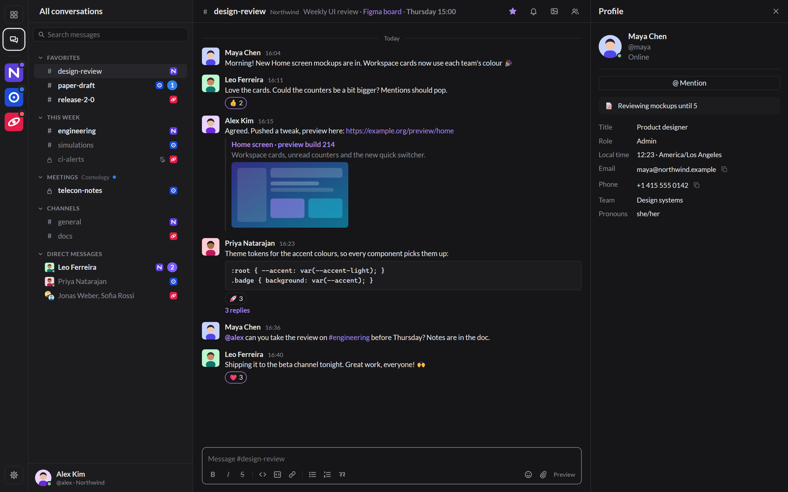

<p align="center"></p>

<h1 align="center">Agora</h1>

<p align="center">
  <b>Slack, Mattermost and Rocket.Chat in one fast, light app.</b><br>
  One Home and one search across every workspace, with fine-tunable notifications.
</p>

<p align="center">
  <a href="https://github.com/nicoborghi/agora/actions/workflows/ci.yml"></a>
  <a href="https://github.com/nicoborghi/agora/releases"></a>
  <a href="https://github.com/nicoborghi/agora/releases"></a>
  
  <a href="https://tauri.app"></a>
  <a href="https://www.rust-lang.org"></a>
  <a href="LICENSE"></a>
  <a href="https://claude.ai"></a>
</p>

<p align="center"></p>

> [!NOTE]
> **Beta.** Agora is used every day by its author, but expect rough edges. Please report what breaks in
> [Issues](https://github.com/nicoborghi/agora/issues).

## More than three apps in one window

Agora is not a wrapper that stacks three web apps in tabs. It talks to each service through its API, turns
everything into one data model, and builds features none of the official clients have across workspaces:

- **One Home for everything.** A card per workspace, in its own colour, with what is new and who mentioned you.
  *All conversations* puts every workspace in one sidebar, with each service's own sections and favourites.
- **Search across every service at once**, even offline: the local archive is indexed, and *Search on the server*
  reaches back further. `from:`, `in:`, quoted phrases and a date filter work the same everywhere.
- **Fine-tunable notifications.** Three levels (Alert, Dot, Silent) set in layers: a default for
  direct messages and one for channels, overridden per workspace, overridden again per conversation (with its own
  sound and popup). Mentions and keywords can break through any level, quiet hours hold everything back, and the
  taskbar shows a dot in each workspace's colour.
- **Organise across services.** Your own groups can mix a Slack channel, a Mattermost team and a Rocket.Chat
  room. Favourites sync both ways where the service allows it.
- **Your history stays with you.** Every message received is kept in a local, encrypted archive (SQLCipher,
  key in Windows Credential Manager), searchable and readable without a connection.
- **People, wherever they are.** Profiles with title, local time, status and contact details; member lists;
  click any @mention or #channel to open it.
- **Writing that feels good.** Markdown toolbar and shortcuts, @mention and :emoji: completion, paste or drop
  images, a built-in image editor (crop, arrows, highlights, text), and a preview of what others will see.
- **Light on your PC.** One native shell (Rust + Tauri, WebView2) instead of one Electron app per service:
  about 100 MB of memory with several workspaces, no framework, no per-service browser.
- **Made to be yours.** Light, dark or system theme, accent colours, three text sizes, compact or wide spacing,
  Lato or Windows fonts.

## Supported chat systems

| Service | Sign-in | Live updates | What works |
|---|---|---|---|
| **Slack** | Your usual Slack login (SSO, Google, e-mail); every workspace of that session at once | RTM websocket | Messages, threads, edits, reactions, files, sidebar sections, Starred, profiles and members, server search |
| **Mattermost** | Your usual login (SSO, GitLab, password, MFA) or a personal access token | Websocket | All of the above, plus several teams, custom categories, two-way favourites, read state synced with other devices |
| **Rocket.Chat** | Login window (SSO, 2FA) or a personal access token | DDP websocket | All of the above, plus teams, discussions, two-way favourites |
| **Demo workspace** | Built in | Simulated | Fake conversations to try Agora without an account |

## Download

Get the installer from the [latest release](https://github.com/nicoborghi/agora/releases). It installs for your user
only (no administrator rights) and needs Windows 10 or 11 with the WebView2 runtime (included in Windows 11).
Then open Settings → Accounts and sign in.

Releases are built automatically: pushing a version tag runs [GitHub Actions](.github/workflows/release.yml), which
compiles Agora, packages the installer and publishes the release; every push to `main` runs the tests
([CI](.github/workflows/ci.yml)).

```bash
git tag v0.1.0-beta.1
```

```bash
git push origin v0.1.0-beta.1
```

# Signing in

## Adding a Mattermost account

Settings → Accounts → **Mattermost** → type the server (`chat.example.org`, a channel link or the login
page address all work) → **Sign in**. A separate window shows the server's own login page, so SSO
(institution / Google / GitLab / SAML), two-factor and passwords behave exactly as in the browser. When
you are in, the window closes by itself. Agora keeps only the session token, in Windows Credential
Manager. The window runs in private mode, so no cookies are left behind.

When the session expires (by default after 30 days for SSO logins), the account turns grey and the
sidebar shows **Sign in**. Fallback: *Use a personal access token instead*, if the server allows them.

One account covers every team you belong to. With more than one team, each team becomes its own sidebar
section, and your Mattermost custom categories become sections of their own, like Slack sections. Favorites are synced both
ways with Mattermost's Favorites category.
What works: channels, DMs and group messages; unread and mention counts synced with the server (reading
on the phone clears them here too); realtime messages, edits, deletions, reactions, typing and presence;
threads; images (served through the app with your token) and link previews; integration posts
(GitLab, Jira, alerts) rendered as text. Other files open in your browser.

## Adding a Rocket.Chat account

Same flow: Settings → Accounts → **Rocket.Chat** → server → **Sign in**, then log in in the window
(SSO, 2FA, password). Agora keeps the user id and login token in Windows Credential Manager. Login tokens
last 90 days by default; after that the account turns grey with a **Sign in** button.
Fallback: a personal access token (Avatar → Account → Personal Access Tokens shows the User ID and token once).

- Teams become sidebar sections and discussions are get a *Discussions* section.
  Favorites sync both ways. DMs you hid in Rocket.Chat stay hidden.
- Rocket.Chat's own Markdown (`*bold*`, `~strike~`) is converted to and from standard Markdown.
  *Preview* in the composer shows exactly what the others receive.
- Live: messages, edits, deletions, reactions, read state from other devices, favorites, new rooms and status.
  Typing indicators are not followed, to keep the traffic down.
- *Search on the server* works only when the admin enabled global search; otherwise only the archive is searched.

## Adding Slack

Settings → Accounts → **Slack** → optionally type the workspace (`acme`, `acme.slack.com` or any link) →
**Sign in**. Slack's own sign-in page opens (Google, SSO, email code, password). The window closes as soon
as the login is done, without waiting for the full Slack client to load. After an email sign-in, Slack lists
your workspaces: Agora adds every one that session is signed in to, and the links there open inside the
sign-in window (they would otherwise try a new tab or the desktop app). To add a workspace later, type its
name and press **Sign in**: Agora first tries the Slack session it already has, so a workspace signed in to
in that session is added at once, with no window. Only otherwise does the sign-in window open. The window title says "loading..." while a page loads. Agora uses the Slack web client's own session (an
`xoxc-` token and the `d` cookie), kept in Windows Credential Manager. No Slack app has to be installed and
no admin approval is needed. Check the workspace policy before using it (see *Pre-publication* in Settings).

- Realtime through `rtm.connect`: messages, edits, deletions, threads, reactions, typing, read state from other
  devices, status of DM partners, new conversations, renames, and changes to your sidebar sections.
- Your *Starred* section shows up as Favorites (workspaces without sidebar sections use Slack's older Stars list).
  Slack lets only its own client change Starred, so a star added in Agora usually stays in Agora only; to
  unstar something starred in Slack, do it in Slack. Custom sidebar sections become sidebar sections in Agora too.
- Slack mrkdwn (`*bold*`, `~strike~`, `<url|label>`, `<@U123>`, `<!here>`) is converted to and from standard
  Markdown, and @mentions show names. *Preview* shows exactly what Slack receives.
- Status: Online, Away, and Do not disturb (snoozes for one hour). Slack has no "offline", so Offline sets Away.
- *Search on the server* uses Slack's own search (`search.messages`).
- When the session ends (sign-out, password change, or after a long time), the account turns grey with **Sign in**.

# Building from source

## Prerequisites (native Windows, not WSL)

| Tool | Why |
|---|---|
| [Rust](https://rustup.rs) (stable, MSVC toolchain) | the app |
| Visual Studio Build Tools, workload "Desktop development with C++" | linker, `nmake` |
| [Node.js](https://nodejs.org) LTS | only to run the Tauri CLI (`npm install` once) |
| [Strawberry Perl](https://strawberryperl.com) | builds the OpenSSL that SQLCipher uses. Git's Perl is **not** enough |
| WebView2 runtime | already included in Windows 11 |

If the SQLCipher/OpenSSL build gives trouble, you can run unencrypted (see below); please open an issue with the error.

## Run

```bash
npm install
npm run dev
```

The first build takes several minutes (OpenSSL + SQLCipher are compiled from source). Then:
Settings (gear icon, or `Ctrl+,`) → Accounts → **Demo workspace**. Fake messages arrive every
8–20 s. Send something in a DM and the other person answers. Close the window and you get
the tray icon with coloured dots and the corner popups.

Fallback without encryption:

```bash
npm run tauri dev -- --no-default-features --features plain-sqlite
```

Core unit tests (notification rules, DND, catch-up order, archive queries):

```bash
cargo test -p agora-core
```

Installer (NSIS, per-user): `npm run build`.

## Feasibility probes

These are standalone, store nothing, and print the latest messages and the realtime handshake.
Each value is asked interactively, or read from the environment variable shown.

```bash
cargo run -p agora-probes -- mattermost
```

```bash
cargo run -p agora-probes -- rocketchat
```

```bash
cargo run -p agora-probes -- slack
```

- **Mattermost** (`MM_SERVER`, `MM_LOGIN`, `MM_PASSWORD`, `MM_MFA`, or `MM_TOKEN`). If the server uses SSO
  (common in large organizations), leave the username empty and paste a personal access token or the value of the
  `MMAUTHTOKEN` cookie from a logged-in browser.
- **Rocket.Chat** (`RC_SERVER`, `RC_LOGIN`, `RC_PASSWORD`, `RC_2FA`, or `RC_USER_ID` + `RC_TOKEN`).
- **Slack** (`SLACK_TOKEN`, `SLACK_D_COOKIE`, optional `SLACK_WORKSPACE_URL`). For the probe only, take them
  from a logged-in browser: open the workspace at `app.slack.com`, DevTools → Application → Cookies →
  `d` (starts with `xoxd-`). For the token, run this in the Console:
  `Object.values(JSON.parse(localStorage.localConfig_v2).teams).map(t => t.name + ' ' + t.token)`.
  The real app captures both automatically from its own login window.


## Layout

```
crates/agora-core   data model, archive (SQLite/SQLCipher), secrets, notification rules,
                    catch-up planning, engine (supervision + event hub), demo connector
crates/agora-mattermost  Mattermost connector (REST v4 + websocket)
crates/agora-rocketchat  Rocket.Chat connector (REST v1 + DDP websocket)
crates/agora-slack       Slack connector (Web API + RTM websocket)
src-tauri           Tauri shell: commands, tray icon (icons/tray-32.rgba plus dots drawn in code), popup window, sign-in window,
                    image proxy (agora:// scheme), factory
ui                  plain HTML/CSS/JS, no framework, no bundler (ui/fonts: Lato, SIL Open Font License)
probes              feasibility scripts
```

Each service is one crate implementing `agora_core::service::Service`. The engine runs every account
in its own supervised task: a panic, an expired token or a network outage in one account only greys
out that account. Reconnection uses exponential backoff with jitter, a 15 s wall-clock check to notice
the PC waking from sleep, and a prioritised catch-up (DMs, groups and favorites first, conversations
without news skipped).

## Memory budget

Target: around 100 MB with several accounts. Where the memory goes, and what keeps it down:

| Part | Estimate | Measures |
|---|---|---|
| WebView2 main window (browser + GPU + renderer processes) | 60–90 MB | No framework. Only the open conversation is in the DOM, capped at 400 messages. Rendering is paused while the window is hidden |
| Popup window | +15–25 MB, only while visible | Created on demand and destroyed when the last note expires |
| Rust core | 5–15 MB | No in-memory message cache: SQLite is the cache, with a 4 MB page cache. The event queue is bounded (1024) |
| Each connector | 1–3 MB | One HTTP client and one socket. Presence only for DM partners. Only ids of known users and channels are kept in memory; everything else is in SQLite |
| Sign-in window | +30–50 MB, only while signing in | Destroyed as soon as the token is captured. Private mode, nothing kept |
| Search index | 0 MB in RAM | SQLite FTS5 on disk (about a third of the archive size), using the same 4 MB page cache. 50 results at most per search |
| Logos, status bar | < 0.1 MB | 64×64 images stored as data URLs; only your own presence is tracked beyond DM partners |
| Home view | < 1 MB | Built from data already loaded plus at most 30 conversations × 3 messages from the archive, only while Home is shown |
| Image editor | 8–30 MB, only while open | One canvas at most 3200 px on the long side, freed on close. Pasted files are not copied until sent |
| Profile pictures in messages | transient | Lazy-loaded, only for the up to 400 messages in the open conversation. WebView2 caches them on disk |
| Images (Mattermost) | transient | Proxied through the `agora` scheme with no copy kept in Rust. The timeline loads the server's resized preview, not the original. WebView2 caches on disk, not in RAM |

Possible later option: unload the main webview when Agora sits in the tray for a long time
(saves about 50 MB, costs about 0.5 s to reopen). Not implemented yet.

## Security notes

- Tokens: Windows Credential Manager only. The archive key is also stored there (entry `Agora/db-key`).
- `agora.json` in the data folder holds only the "archive is encrypted" flag.
- Links always open in the default browser. Message HTML is always escaped, and a CSP is set.
- Slack sign-in keeps the same web-session token (`xoxc` + `d` cookie) the Slack web app uses. Check your
  workspaces' policies on third-party clients and on keeping a local message archive.

## Roadmap

Done: the common core and archive, the Demo workspace, the Mattermost, Rocket.Chat and Slack connectors, Home,
cross-service search with dates, notification levels and quiet hours, groups, profiles and members, the image
editor, themes and accent colours, automated releases.

Next: signed auto-update (the release workflow is ready for the signing key), start with Windows, single instance,
an image cache with a size limit, custom emoji. Mac and Linux builds are possible (Tauri runs there) but not
planned for the beta.

## License

Copyright (C) 2026 Nicola Borghi. Agora is free software under the [GNU General Public License v3.0 or later](LICENSE):
you can use, study, share and modify it, and versions you distribute must stay under the same licence.

The bundled Lato font is under the [SIL Open Font License](ui/fonts/OFL.txt); the emoji
shortcode table (`ui/js/emoji-data.js`) is generated from [emoji-datasource](https://github.com/iamcal/emoji-data) (MIT).
